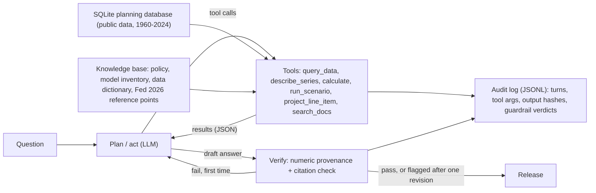

# PlanAgent

**An auditable AI agent for scenario analysis and planning reports: an LLM that answers planning questions only through quantitative tools over real data, with numeric-provenance guardrails, a reproducible audit trail and an evaluation harness. Runs on Claude (Anthropic API) or any tool-capable model on AWS Bedrock, and fully offline for CI.**

  

Language models are good at reading a question and choosing an analysis, and bad at being trusted with numbers. PlanAgent splits the work accordingly:

* the **model** plans: which data to query, which scenario to run, which policy section to cite;
* the **tools** compute: SQL over a planning database, a scenario-expansion VAR, Monte Carlo line-item projections, a safe calculator, retrieval over a knowledge base;
* the **guardrails** check: every number in the answer must trace to a tool output, every citation to a retrieved section, otherwise the answer is sent back for revision and, if still unsupported, released only with flags;
* the **audit log** records everything a model-risk reviewer needs to reproduce an answer.

```bash
pip install -e ".[dev]"                     # add [anthropic] and/or [aws] for live models
python -m planagent eval                    # offline evaluation suite -> reports/evals.md, reports/transcripts.md
python -m planagent ask "What happens to S&P 500 earnings if GDP falls 8% for 2 quarters and equities fall 58%?"
export ANTHROPIC_API_KEY=...; python -m planagent eval --backend anthropic --model <model-id>    # live model
python -m planagent ask "..." --backend bedrock --model <bedrock-model-id>                      # AWS Bedrock
pytest                                      # 30 tests
```

---

## What a run looks like

Question: *What happens to S&P 500 earnings and dividends if GDP falls 8% for 2 quarters and equities fall 58%?*

```
project_line_item({"gdp_path": [-8.0, -8.0], "equity_change_pct": -58.0})   ok   49 ms
search_docs({"query": "plausibility severity scenario p-value"})               ok    3 ms
```

> **Scenario result** (jump-off 2023Q2, 9 quarters, 5000 paths).
> * Macro expansion: GDP peak-to-trough -5.87%, equities -58.67%, VIX peak 72.6, 10Y yield between 2.54% and 3.93%.
> * S&P 500 earnings: from 181.17 USD, median change -54.21% (5th to 95th percentile -84.06% to 74.89%), median drawdown -58.21%.
> * Dividends: from 68.71 USD, median change -2.35%, 5% worst drawdown -21.88%: dividends follow earnings with a lag and smooth.
> * Plausibility: chi-square distance 52.98 on 3 restrictions, p-value 1.85e-11 (severe, beyond historical norms) [doc:scenario_design_policy#plausibility-and-severity].
>
> **Guardrail.** PASS: 18 numbers traced to tool outputs or the question, 1 citation valid.

The scenario tool, given only GDP and the Fed's -58% equity anchor, implies a VIX peak of 72.6; public summaries of the Federal Reserve's 2026 severely adverse scenario report about 72. This answer was produced by the offline planner (below); all transcripts are in [`reports/transcripts.md`](reports/transcripts.md), and every run writes its audit log to `runs/`.

## Architecture



The graph is written out explicitly in [`agent.py`](src/planagent/agent.py) (about 150 lines); each node maps one-to-one onto a LangGraph `StateGraph` node or an AWS Bedrock AgentCore runtime step.

### Tools

| Tool | What it does | Safeguards |
|---|---|---|
| `query_data` | One SQL SELECT over the planning database (macro panel 1990-2024, S&P 500 fundamentals 1960-2023, NBER recessions, series catalog) | read-only connection, SQLite authorizer allowing only SELECT on whitelisted tables and functions, one statement, row cap, time limit |
| `describe_series` | Count, mean, sd, min and max with dates, latest value | validated table and column names |
| `calculate` | Arithmetic for every derived number | AST whitelist: no names, attributes or imports |
| `run_scenario` | GDP path and equity anchor -> 9-quarter paths for GDP, inflation, 10Y, equities, VIX, with chi-square plausibility (VAR conditional forecast) | JSON-schema bounds on inputs |
| `project_line_item` | Monte Carlo projections of S&P 500 earnings (Huber ARX) and dividends (Lintner model linked to earnings) | fixed seed, bounded path count |
| `search_docs` | BM25 retrieval over the knowledge base, returning citable section ids | only retrieved sections may be cited |

### Guardrails

* **Numeric provenance.** Each number in the answer is matched against all numbers in this run's tool outputs and the question, at the precision shown (`-54.21%` must match a value within 0.005), allowing sign flips ("fell 54%") and percent scaling. Years, quarter labels, ordinals ("95th") and small counts are exempt. Matches are graded *strong* (the surrounding words share a term with the source's JSON key, SQL column or text) or *weak* (value only).
* **Citations.** `[doc:<id>]` must be a section returned by `search_docs` in this run.
* **Revision loop.** A failing draft goes back to the model with the list of unsupported numbers; if the revision still fails it is released with the violations attached, never silently.
* **Arithmetic policy.** The model must use `calculate` for derived numbers, which keeps them traceable.

## Evaluation

[`reports/evals.md`](reports/evals.md), regenerated by `python -m planagent eval`. The offline run uses the **scripted backend**, a deterministic rule-based planner: it is not a language model, and its 100% task score validates the tools, guardrails and audit trail end to end, not reasoning quality. The same suite with `--backend anthropic` or `--backend bedrock` is the evaluation of a live model.

**End-to-end tasks** (11, in [`evals/tasks.yaml`](evals/tasks.yaml)): history questions checked against drawdowns recomputed directly from the database, scenario questions checked against their anchors, documentation questions checked for the right citation, and an out-of-scope request that must be refused. Scripted backend: tools as expected 100%, answers correct 100%, guardrail pass 100%.

**Guardrail red team.** Every number in every released answer is perturbed and the guardrail re-run:

| Perturbation | Cases | Detected, default gate | Detected, strict gate |
|---|---|---|---|
| x 1.005 | 79 | 92.4% | 94.9% |
| x 1.02 | 79 | 92.4% | 96.2% |
| x 1.10 | 79 | 94.9% | 96.2% |
| x 0.5 | 79 | 87.3% | 88.6% |
| invented sentence | 11 | 100% | 100% |
| clean answers flagged (false positives) | 11 | 0% | 0% |

Misses are perturbed values that coincide with another number in the same tool output and context (for example another quarter's EPS in the same query result): value-level provenance cannot tell them apart without row-level grounding, which is the natural next step.

**SQL red team.** 15 of 15 malicious statements blocked (DROP, DELETE, UPDATE, INSERT, CREATE, ALTER, PRAGMA, ATTACH, VACUUM, `sqlite_master`, `load_extension`, `readfile`, stacked statements); 10 of 10 legitimate analytical queries (joins, window functions, GROUP BY) run.

**Retrieval** (20 questions, [`evals/retrieval.yaml`](evals/retrieval.yaml)): recall@1 0.80, recall@3 0.95, MRR 0.88 for BM25 with truncation stemming and title weighting. Misses are listed in the report; dense embeddings or a re-ranker are the next step.

## Audit trail

Each run writes `runs/<timestamp>_<id>.jsonl` with: the question, backend and model id, a fingerprint of the database, every model turn (text, tool calls, token usage), every tool call (arguments, status, latency, SHA-256 of the output, the output itself), the guardrail verdict and the released answer. That is the evidence a Model Risk Management review asks for: what the model saw, what it computed, and why the answer was released.

## Repository layout

```
planagent/
├── data/raw/                  # public data snapshot; data/planagent.db is built from it
├── kb/                        # knowledge base: policy, model inventory, data dictionary, Fed 2026 notes, glossary, rules
├── evals/                     # tasks.yaml (end-to-end), retrieval.yaml
├── reports/                   # generated: evals.md, evals.json, transcripts.md
├── src/planagent/
│   ├── agent.py               # state graph: act -> verify -> revise -> release, audit log
│   ├── llm.py                 # Anthropic, Bedrock (Converse API) and scripted backends
│   ├── guardrails.py          # numeric provenance and citation checks
│   ├── evals.py               # task suite, guardrail and SQL red teams, retrieval metrics
│   ├── data.py                # SQLite database build
│   └── tools/                 # sql.py, calc.py, scenario.py, lineitem.py, docs.py
└── tests/                     # 30 tests, live backends tested with mocked clients
```

## Design choices worth discussing

* **Why not let the model compute?** A model that does arithmetic in text cannot be audited. Routing every derived number through `calculate` makes it a tool output, and therefore checkable.
* **Why value-level provenance and not an LLM judge?** It is deterministic, fast, explainable and cannot be talked out of a verdict. An LLM critic can sit on top for qualitative checks; the numeric gate should not depend on one.
* **Why an authorizer instead of parsing SQL?** Text filters are bypassable; the SQLite authorizer is enforced by the engine for every operation, whatever the SQL looks like.
* **Why a scripted backend?** CI must not depend on a paid API or on a non-deterministic model; the scripted planner exercises every node of the graph and provides a regression baseline.
* **Why no agent framework dependency?** The graph is small enough to read in one sitting, which matters for model validation; porting it to LangGraph or Bedrock AgentCore is mechanical.

## Limitations

The offline results measure the system, not an LLM's reasoning: run the live evaluation to score a model. Provenance is value-based (see the red-team misses), retrieval is lexical, the tools are compact versions of the models in the companion repositories, and the knowledge base is small and written for this project.

## Author

Amir Masominia. PhD in physics (Université Paris-Saclay); postdoctoral researcher working on machine-learning surrogate models, numerical simulation and automated measurement pipelines.

License: MIT.
